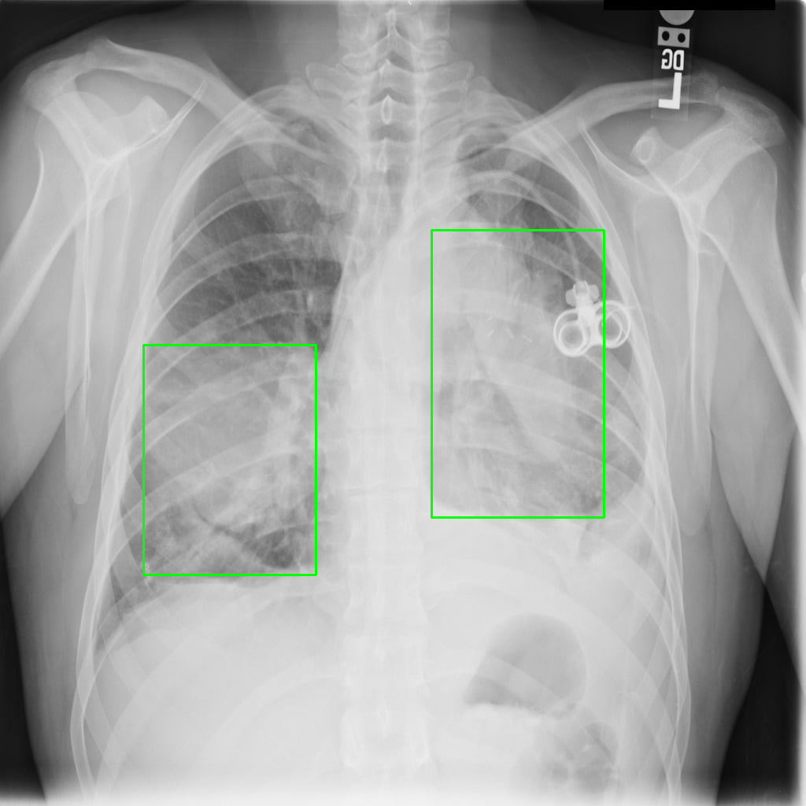

# 🧠 Pneumonia Detection Using CNN

This is a deep learning-based project for detecting and localizing pneumonia in chest X-ray images using Convolutional Neural Networks (CNNs). The model is built using **U-Net** with **ResNet50** and **MobileNetV2** as encoder backbones. Trained in **Python** using **TensorFlow/Keras**, it achieves high accuracy and IoU scores.

📌 **Goal**: Automate diagnosis support by segmenting pneumonia-affected regions from chest X-rays.

---

## 📊 Key Achievements

- ✅ **96% classification accuracy** with **0.81 mean IoU** using **ResNet50** encoder  
- ✅ **87% accuracy** with **0.76 IoU** using **MobileNetV2**  
- ⚙️ U-Net encoder-decoder architecture for semantic segmentation  
- 🧼 Custom image preprocessing pipeline for clean inputs  
- 📉 Visualizations of prediction maps, metrics, and overlays

---

## 🛠️ Tech Stack

- **Python 3.10**  
- **TensorFlow / Keras**  
- **U-Net**, **ResNet50**, **MobileNetV2**  
- **Matplotlib** – result visualization  
- **Flask** (via `app.py`) – optional backend integration  
- **OpenCV** – image preprocessing  
- **Google Colab** – for training

---

## 📁 Project Structure

```
BackendForML/
├── pycache/
├── saved_model_dir/
│   ├── variables/
│   ├── saved_model.pb
├── saved_res_model_dir/
│   ├── variables/
│   ├── saved_model.pb
├── static/                  # X-ray output images (segmentation/localization)
│   ├── pred1.png
│   ├── pred2.png
│   ├── ...
├── app.py                   # Flask app to serve predictions
├── conversion.py            # Model format conversion if needed
├── requirements.txt         # Project dependencies
├── tempCodeRunnerFile.py
├── test.py                  # Testing scripts or model evaluation
└── README.md
```

---

## 🚀 Getting Started

### Prerequisites

- Python 3.10+  
- Virtualenv (recommended)

### Setup

```bash
git clone https://github.com/saamirkc/BackendForML.git
cd BackendForML

# (Optional) Create and activate virtual environment
python -m venv venv
source venv/bin/activate  # or venv\Scripts\activate on Windows

# Install dependencies
pip install -r requirements.txt
```

---

## 🧪 Running the Project

**Option 1:** Run Flask API locally  
```bash
python app.py
```

**Option 2:** Test predictions manually  
```bash
python test.py
```

---

## 🩻 Sample Outputs

Below are example outputs from the model showing pneumonia detection and localization results:

### 🔍 Predicted X-ray Segmentations

<p align="center">
  
  
</p>

These images show ground truth vs predicted segmentation maps and overlay masks highlighting infected regions.

---

## 📈 Evaluation Metrics

- **Accuracy**
- **Mean IoU (Intersection over Union)**
- **Dice Coefficient**
- **Precision / Recall**
- **Confusion Matrix**
- **Segmentation Maps**

---